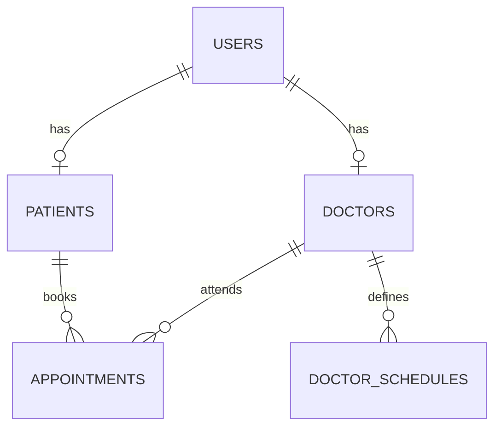

# HMS — Hospital Management System

A Java-based hospital management system focused on organizing patients, doctors, medical schedules, and appointments.

> **Scope:** HMS is a software engineering project, not a production-ready clinical system. Use fictional data only; it has not been validated for handling real patient records.

## Tech Stack

| Area | Technology |
| --- | --- |
| Language | Java 21 |
| Framework | Spring Boot 4 |
| Persistence | Spring Data JPA / Hibernate |
| Database | MySQL |
| Build tool | Maven |

## Domain Model

The initial data model includes:

- **Users:** shared identity and contact information.
- **Patients:** patient profiles linked to users.
- **Doctors:** doctor profiles, medical registration (CRM), and specialty.
- **Doctor schedules:** recurring availability by weekday and time range.
- **Appointments:** patient–doctor bookings, appointment type, reason, and status.

### Entity Relationships



The database schema uses primary and foreign keys, uniqueness constraints, and checks for time ranges. Java entities map these relationships through JPA annotations.

## Project Structure

```text
in development
```

Additional application layers will be documented here as they are implemented and verified.

## Getting Started

### Prerequisites

- JDK 21
- Maven
- MySQL Server

### Database Setup

1. Create the `HMSdb` database and its tables using the project's SQL schema. The required tables are `users`, `patients`, `doctors`, `doctor_schedules`, and `appointments`.
2. Create a dedicated MySQL application user with access to `HMSdb`.
3. Configure the datasource in `src/main/resources/application.properties`. The following is an **example configuration**, not a claim about the current contents of that file:

```properties
spring.application.name=hms
spring.datasource.url=jdbc:mysql://root:3306/HMSdb
spring.datasource.username=${HMS_DB_USERNAME}
spring.datasource.password=${HMS_DB_PASSWORD}
spring.jpa.hibernate.ddl-auto=validate
spring.jpa.open-in-view=false
```

With `ddl-auto=validate`, Hibernate checks the existing schema; it does **not** create the tables. The SQL schema must be applied before starting the application.

### Run Locally

From the project directory, set the credentials in your shell and start the application:

```bash
export HMS_DB_USERNAME="your_mysql_username"
read -rsp "MySQL password: " HMS_DB_PASSWORD; echo
export HMS_DB_PASSWORD
mvn spring-boot:run
```

If your local configuration uses a different username property, update it to match your MySQL account. Do not commit actual credentials.

### Tests

```bash
mvn test
```

Tests that initialize the Spring application context may also require a configured database. Test coverage and verified execution scenarios will be documented as they are added.

## Roadmap

- [x] Initial SQL schema design and JPA domain mapping.
- [ ] Verify persistence end to end with integration tests.
- [ ] Implement and validate patient, doctor, and appointment workflows.
- [ ] Enforce appointment availability and prevent scheduling conflicts.
- [ ] Add authentication, authorization, and input validation.
- [ ] Document working endpoints or user-facing screens with examples.

The roadmap describes planned work; unchecked items should not be interpreted as implemented functionality.

## Security and Data Privacy


- Use fictional data for development, testing, and demonstrations.
- Do not use HMS with real medical records without appropriate security, privacy, and regulatory review.

## License

Distributed under the [MIT License](LICENSE).
